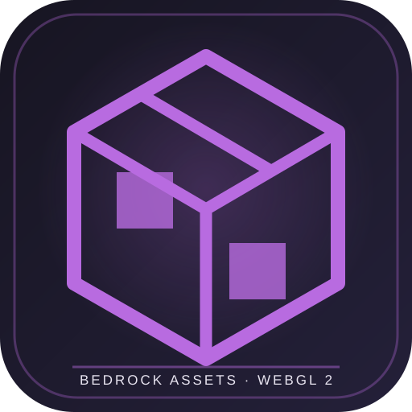

**EXPERIMENTAL WEBGL 2 RENDERER**

---

# Minecraft WebLab

**An experimental browser-based 3D renderer for selected Minecraft Bedrock resource-pack assets.**

Minecraft WebLab explores how far selected Bedrock resource data can be interpreted in an independent web runtime. It is a rendering and compatibility experiment, not a browser port of the original Minecraft engine.

[Live preview](https://minecraft-weblab.vercel.app)

## Project goals

- Load supported resource-pack data locally in the browser.
- Resolve selected block definitions and texture mappings.
- Build chunk geometry and render it through WebGL 2.
- Test rendering and input on desktop and mobile browsers.
- Document the compatibility gap between resource-pack data and a full game engine.

## Engine capabilities

The current experimental core includes:

- **WebGL 2** with GLSL ES 3.00 shaders, depth testing, and back-face culling.
- **Chunk geometry** using compact 16×16×height typed arrays.
- **Greedy meshing** to merge compatible faces and remove internal faces.
- **Texture atlas** support for PNG, JPEG, WebP, and TGA, including TGA RLE.
- **Bedrock asset indexing** for selected block and material identifiers.
- **Procedural test world** with terrain layers and trees.
- **First-person controls** using keyboard/mouse and mobile touch controls.
- **Local resource loading** so resource-pack files can remain on the user's device.

## Requirements

- Node.js with npm.
- A modern browser with WebGL 2 support.
- A Minecraft Bedrock resource-pack folder or a prepared asset bundle for meaningful custom-resource testing.

## Run locally

Install dependencies with npm install, then start the development server with npm run dev. Open the local Vite address and select the /engine/ route.

Build with npm run build and run the test suite with npm test.

Prepare resource assets from a local resource-pack extraction with:

    npm run prepare:bedrock-assets -- --input "/path/to/resource_packs" --output public/bedrock-assets

The prepared folder can be selected in the browser or packaged as a ZIP and loaded by the engine. A compatible resource pack should contain files such as blocks.json and textures/terrain_texture.json.

## Repository structure

| Path | Responsibility |
| --- | --- |
| src/engine/render/ | WebGL renderer and texture atlas. |
| src/engine/world/ | Block registry, chunk data, terrain generation, and greedy meshing. |
| src/engine/assets/ | Resource-pack loading, demo assets, and local cache. |
| src/engine/input/ | First-person input and camera controls. |
| tools/bedrock/ | Local resource preparation utilities. |
| tests/ | Automated tests for core engine behavior. |
| docs/ | Architecture, compatibility analysis, and roadmap. |

## Validation

The current test suite includes checks for storage, mesh winding, greedy merging, chunk seams, and face materials. Run npm test to execute the available tests.

A successful test run does not replace visual testing with real GPU hardware. Deployment behavior and Chrome Android compatibility still need device-level validation.

## Current limitations

This project **does not execute the original Minecraft APK** and is not an official conversion of the Bedrock engine. It interprets a subset of resource-pack data in a separate runtime.

Features still outside the current scope include full game physics and collision, raycasting, block placement and breaking, complete lighting and ambient occlusion, biome tinting, correct transparency and water, special Bedrock models, entities, animations, inventory, world saving, and multiplayer.

Resource packs and game files must be supplied by the user. Do not commit APKs, proprietary game assets, or large extracted resource folders to this public repository.

## Technical notes

- Package version: 0.3.0
- Development server and build: Vite
- Runtime rendering: WebGL 2 / GLSL ES 3.00
- Tests: Node.js built-in test runner

See the ENGINE-CORE, ENGINE-ROADMAP, and Bedrock asset reuse documentation in the docs folder for implementation details.
